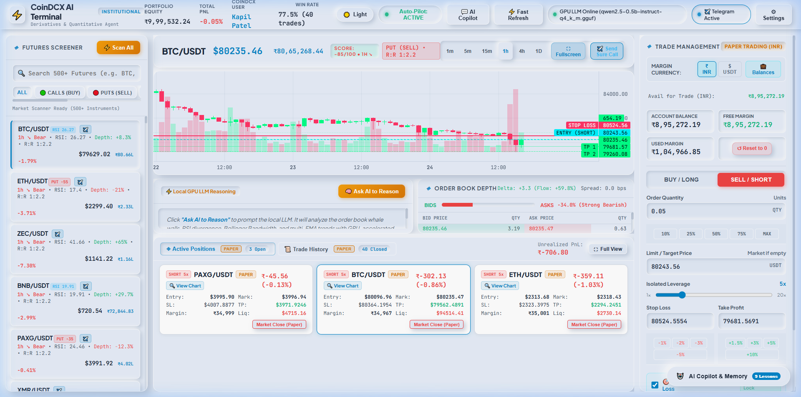
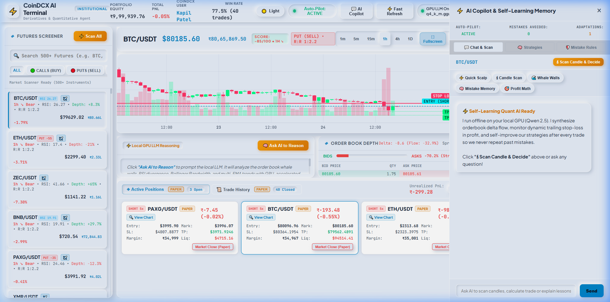
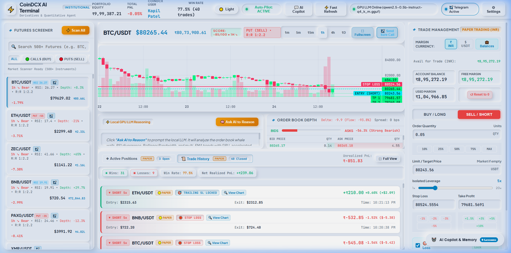
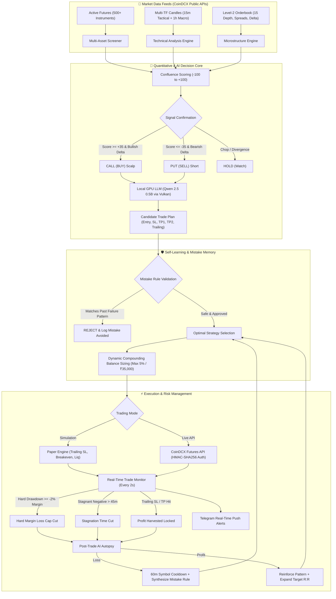

# ⚡ CoinDCX AI-Trader: Institutional Futures Trading & Autonomous Quantitative Terminal

[](https://www.python.org/)
[](https://fastapi.tiangolo.com/)
[](https://tradingview.github.io/lightweight-charts/)
[](https://huggingface.co/Qwen)
[](LICENSE)
[](#)

A quantitative derivatives terminal and autonomous algorithmic trading system powered by **CoinDCX Derivatives APIs**, **Real-Time Order Book Microstructure**, **Multi-Timeframe Quantitative Screening**, and a **Local GPU-Accelerated LLM Agent** that runs offline on consumer hardware with zero cloud API latency or ongoing token fees.

---

## 📸 Terminal Interface & Visual Tour

### 1. Institutional Multi-Asset Trading Terminal
Modern Neumorphic financial interface featuring zero-latency TradingView candlestick charts, Level-2 live order book depth with whale wall absorption indicators, 500+ futures contract screener with Call/Put direction filters, and active risk tracking.



### 2. Autonomous AI Copilot & Self-Learning Memory Drawer
The system conducts automatic post-trade autopsies after every trade. Losing trades formulate strict negative rules to prevent repeat traps, while winning setups reinforce dynamic risk-to-reward expansions.



### 3. High-Precision Trade History & Execution Log
Complete trade fills log with real-time profit and loss metrics, trailing stop locks, breakeven triggers, and execution timestamps.



---

## 🧠 System Architecture & Working Principle



---

## 🚀 Key Features

### 1. Multi-Timeframe Quantitative Screener
- **500+ Crypto Futures Contracts**: Screen the entire CoinDCX futures market in real time.
- **Dual-Timeframe Alignment**: Combines **15-minute tactical execution** with **1-hour macro trend direction** to avoid entering against the prevailing market tide.
- **Categorized Filters**:
  - `🟢 CALLS (BUY)`: Bullish multi-EMA trend alignment, RSI momentum (> 50), and aggressive buyer absorption.
  - `🔴 PUTS (SELL)`: Bearish breakdown, RSI resistance (< 50), and dominant seller delta.
- **Stale Data Protection**: Automatically disqualifies coins with candles older than 90 minutes or price discrepancies exceeding 2.5% between order book and candles.

### 2. Level-2 Order Book Microstructure & Whale Walls
- **Real-Time Delta (Bids - Asks)**: Measures buyer vs seller volume flow across the top 15 depth levels.
- **Whale Wall Detection**: Automatically highlights massive bid defense walls or overhead sell walls with visual badges.
- **Spread Monitoring**: Real-time bid-ask spread tracked in basis points (bps) to prevent entering illiquid slippage traps.

### 3. Local GPU-Accelerated LLM Agent (Offline / Zero Cost)
- **Embedded Local Model**: Pre-configured for `qwen2.5-0.5b-instruct-q4_k_m.gguf` running through standalone `llama-server.exe` with Vulkan / GPU VRAM acceleration (`-ngl 99`).
- **No Cloud API Subscriptions**: Runs 100% locally on your computer with fast, private inference and zero monthly OpenAI/Anthropic API bills.
- **Structured Trade Thesis**: Streams tactical trade setups directly to the UI, detailing market regime, candle wick validation, invalidation points, and mistake avoidance.

### 4. Autonomous Self-Learning Strategy Engine
- **Mistake Memory & Auto-Correction**: Analyzes every losing trade using post-trade AI autopsies and formulates actionable negative rules to prevent repeat mistakes.
- **60-Minute Circuit Breaker**: If a symbol is stopped out, it is locked out for 60 minutes to eliminate emotional re-entries.
- **4 Evolving Strategies**:
  1. **Delta Momentum Surge**: Captures high-momentum breakouts backed by orderbook delta volume.
  2. **Microstructure Wall Absorption**: Fades extreme imbalances or enters alongside dominant whale walls.
  3. **Oversold Flow Reversal**: Catches bottom exhaustion when RSI is deeply oversold and buyer flow returns.
  4. **Breakdown Delta Short**: Enters breakdown shorts when top gainers exhaust and sell delta surges.
- **Dynamic Compounding Position Sizing**: Capitalizes on winning streaks by dynamically reinvesting profits (strictly capped at 5% of balance / max ₹35,000) while automatically reducing size during drawdowns.

### 5. Strict Risk Controls & Capital Preservation
- **Hard Margin Risk Cap**: If any position loses more than **-2.0%** of margin allocation (or ₹2,500), it is instantly auto-liquidated with `MAX_LOSS_CAP_PROTECTION`.
- **Stagnation Cut**: If a trade hovers in negative PnL for **> 45 minutes** without breaking out, it is automatically terminated with `STAGNATION_TIME_CUT`.
- **Dynamic Trailing Stop Loss**: Locks in profits as price advances and transitions stop loss to Breakeven (+0.8%) once initial profit threshold is crossed.

### 6. Dual-Mode Trading Engine
- **Paper Trading Simulation**: Default ₹10,00,000 INR ($10,000 USD) virtual account for risk-free quantitative backtesting and forward live testing.
- **CoinDCX Live Futures Execution**: Toggle live trading in Settings with HMAC-SHA256 authenticated order placement and balance sync.

---

## 📁 Repository Structure

```
Ai-Trader/
├── backend/
│   ├── main.py                   # FastAPI application, WebSocket hub, REST routes
│   ├── auto_trader.py            # Autonomous trading loop & decision dispatch
│   ├── self_learning.py          # Mistake memory, strategy evolution & compounding sizing
│   ├── coindcx_client.py         # Async CoinDCX Futures client (HMAC-SHA256 signatures)
│   ├── technical_analysis.py     # Multi-timeframe indicators (RSI, EMA, MACD, Orderbook)
│   ├── scanner.py                # 500+ contract scanner with CALL/PUT ranking
│   ├── paper_engine.py           # Simulation engine with hard caps & trailing SL
│   ├── llm_engine.py             # Local llama-server manager (Vulkan / GPU priority)
│   └── telegram_notifier.py      # Real-time Telegram bot push alerts
│
├── static/
│   ├── index.html                # Neumorphic trading terminal interface
│   ├── css/
│   │   └── terminal.css          # Neumorphic light/dark fintech styling
│   └── js/
│       ├── app.js                # Core UI coordinator, WebSocket sync, trade views
│       ├── chart.js              # TradingView Lightweight Charts price line overlays
│       ├── orderbook.js          # Orderbook depth visualizer & whale wall tracker
│       └── scanner.js            # Multi-asset screener with Call/Put filters
│
├── data/
│   ├── config.example.json       # Settings template for API keys & Telegram config
│   ├── paper_account.json        # Persistent paper account state & closed trade history
│   └── self_learning_strategies.json # Learned mistake rules, winning patterns & strategy logs
│
├── docs/
│   └── images/                   # Documentation screenshots & architecture diagrams
│
├── download_llm.py               # Automated local LLM & llama-server downloader
├── requirements.txt              # Python dependencies
├── start.bat                     # Windows one-click automated launcher
├── .gitignore                    # Excludes LLM models, binaries, and credentials
└── README.md                     # Institutional documentation
```

---

## 🛠️ Quick Start & Installation

### Prerequisites
- **Operating System**: Windows 10/11 or Linux (Ubuntu 20.04+)
- **Python**: Version `3.10` or higher
- **GPU (Optional but recommended)**: Any NVIDIA GPU (Kepler, Turing, Ampere, Ada Lovelace) or integrated GPU with Vulkan support.

### 1. Clone the Repository
```bash
git clone https://github.com/kapilpatel89/Ai-Trader.git
cd Ai-Trader
```

### 2. Install Python Dependencies
```bash
pip install -r requirements.txt
```

### 3. Download the Local LLM & Binaries
Run the automated downloader script to fetch the lightweight Qwen 2.5 0.5B GGUF model and Vulkan GPU binaries (models are excluded from Git to keep the repository lightweight):
```bash
python download_llm.py
```

### 4. Configure Environment & Keys (Optional)
Copy the configuration template:
```bash
cp data/config.example.json data/config.json
```
Edit `data/config.json` if you wish to configure live CoinDCX API keys or Telegram push alerts:
```json
{
  "coindcx_key": "YOUR_COINDCX_API_KEY",
  "coindcx_secret": "YOUR_COINDCX_SECRET_KEY",
  "live_trading_enabled": false,
  "default_leverage": 5,
  "telegram_bot_token": "YOUR_TELEGRAM_BOT_TOKEN",
  "telegram_chat_id": "YOUR_TELEGRAM_CHAT_ID",
  "telegram_enabled": false
}
```
*(Leave `live_trading_enabled: false` to trade in Paper Simulation mode safely.)*

### 5. Launch the Terminal
#### On Windows (One-Click):
Double-click `start.bat` or run:
```cmd
start.bat
```

#### On Linux / Manual Command:
```bash
python -m uvicorn backend.main:app --host 127.0.0.1 --port 8000
```
Open your web browser and navigate to:
```
http://127.0.0.1:8000
```

---

## 📊 Quantitative Scoring Formula

The scanner evaluates each asset through a multi-factor quantitative scoring algorithm:

$$\text{Quant Score} = w_{\text{trend}} \cdot S_{\text{EMA}} + w_{\text{rsi}} \cdot S_{\text{RSI}} + w_{\text{delta}} \cdot S_{\text{OB}} + w_{\text{candle}} \cdot S_{\text{Candle}}$$

Where:
- **EMA Trend Factor** ($w_{\text{trend}} = 35\%$): Multi-timeframe EMA alignment (EMA 9 > 21 > 50 > 200).
- **RSI Momentum Factor** ($w_{\text{rsi}} = 20\%$): Normalized distance from neutral 50, penalized for extreme overbought (> 72) or oversold (< 26) exhaustion.
- **Order Book Microstructure** ($w_{\text{delta}} = 30\%$): Bid-Ask volume imbalance and top-5 level buyer absorption.
- **Candle Formation Factor** ($w_{\text{candle}} = 15\%$): Candle body dominance, rejection wicks, and pattern confirmation.

---

## 🔒 Security & Privacy Notice

- **No Remote Token Leakage**: The local LLM runs completely offline inside `llama-server.exe` on your localhost. Your prompts, trades, and strategy patterns are never sent to third-party AI APIs.
- **API Key Storage**: API keys are saved strictly on your local disk in `data/config.json`, which is permanently excluded via `.gitignore`.
- **HMAC Authentication**: Live CoinDCX requests use industry-standard HMAC-SHA256 signatures with localized timestamps.

---

## ⚖️ Disclaimer

*This software is developed for educational, quantitative research, and paper-trading simulation purposes. Cryptocurrency futures trading involves substantial risk of loss and is not suitable for every investor. Past simulation results do not guarantee future performance. Ensure you perform thorough risk management before deploying real capital.*

---

## 📜 License

Distributed under the [MIT License](LICENSE). Free for open-source research and quantitative development.
